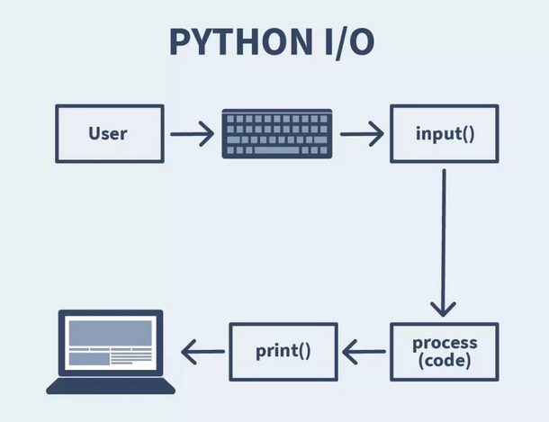

:experimental:
:icons: font
:source-highlighter: rouge
:toc: left
:toclevels: 5
:sectnums:

= Hoofdstuk 8: Input en Files

Een programma wordt pas echt interessant als het iets met de buitenwereld doet. Het kan vragen stellen aan de gebruiker en het kan gegevens bewaren, ook nadat het programma is afgesloten.

In dit hoofdstuk leer je:

* hoe je met `input()` gegevens van de gebruiker vraagt;
* hoe je die input omzet naar een getal en ermee rekent;
* hoe je input en `if`-structuren combineert in een kleine game;
* hoe je een ##file## (een bestand) opent, leest, schrijft en sluit;
* hoe je met `with` veilig met files werkt.

Voor de berekeningen gebruiken we de expressies uit hoofdstuk 3.

== Input van de gebruiker

Een game of programma wordt interactief als het vragen kan stellen aan de speler. De ##input## (de invoer) vraag je met de functie `input()`. Het programma wacht tot de speler iets typt en op kbd:[Enter] drukt.

=== Tekst vragen met input()

[source,python]
----
player_name = input("Voer je naam in: ") <1>
print("Welkom, " + player_name + "!") <2>
----
<1> Tussen de haakjes staat de vraag die op het scherm verschijnt. Wat de speler typt, komt in de variabele `player_name`.
<2> We plakken de naam van de speler in een welkomstbericht.

.Uitvoer (de speler typt Sam)
[source,plaintext]
----
Voer je naam in: Sam
Welkom, Sam!
----

=== Een keuze laten maken

Met input kan een speler een keuze maken. De ##output## (de uitvoer) past zich aan op wat de speler typt.

[source,python]
----
choice = input("Wil je naar links of rechts gaan? ")
print("Je hebt gekozen om naar " + choice + " te gaan.")
----

.Uitvoer (de speler typt links)
[source,plaintext]
----
Wil je naar links of rechts gaan? links
Je hebt gekozen om naar links te gaan.
----

== Rekenen met input

Met expressies kan je berekeningen doen met de input van een speler. In een RPG-game richten spelers bijvoorbeeld schade aan bij vijanden.

=== Gevechtsberekening

[source,python]
----
player_damage = int(input("Voer je schade in: ")) <1>
enemy_health = 100
remaining_health = enemy_health - player_damage <2>

if remaining_health <= 0:
    print("De vijand is verslagen!")
else:
    print("De vijand heeft nog", remaining_health, "gezondheid over.")
----
<1> `input()` geeft altijd een string (`str`) terug, ook als de speler een getal typt. Met `int()` zetten we die string om naar een integer, zodat we ermee kunnen rekenen.
<2> De resterende gezondheid is de gezondheid van de vijand min de schade van de speler.

.Uitvoer (de speler typt 30)
[source,plaintext]
----
Voer je schade in: 30
De vijand heeft nog 70 gezondheid over.
----

WARNING: Typt de speler geen getal, bijvoorbeeld `dertig`, dan stopt het programma met een foutmelding (`ValueError`). Hoe je dat opvangt, leer je in een later hoofdstuk.

=== Attributen van een personage

In een rollenspel past de speler de kracht en behendigheid van zijn personage aan.

[source,python]
----
player_name = input("Creëer je personage. Geef een naam: ")
player_strength = int(input("Voer de krachtwaarde in (1-10): "))
player_agility = int(input("Voer de behendigheidswaarde in (1-10): "))
total_points = player_strength + player_agility <1>

print(player_name + "'s attributen:")
print("Kracht:", player_strength)
print("Behendigheid:", player_agility)
print("Totaal punten:", total_points)
----
<1> Het totaal is een gewone berekening met de twee getallen die de speler heeft ingevoerd.

.Uitvoer (de speler typt Aria, 7 en 5)
[source,plaintext]
----
Creëer je personage. Geef een naam: Aria
Voer de krachtwaarde in (1-10): 7
Voer de behendigheidswaarde in (1-10): 5
Aria's attributen:
Kracht: 7
Behendigheid: 5
Totaal punten: 12
----

== Input en if combineren

Als je input en `if`-structuren combineert, krijg je een spel dat anders verloopt naargelang de keuze van de speler. Stel dat je een avonturenspel maakt waarin de speler een mysterie moet oplossen:

.landhuis.py
[source,python]
----
player_name = input("Voer je naam in: ")
print("Welkom, " + player_name + "!")
print("Je staat voor een oud landhuis. Wat wil je onderzoeken?")
choice = input("1. De voordeur 2. Het zijraam: ") <1>

if choice == "1": <2>
    print("Je betreedt het landhuis via de voordeur en voelt een koude windvlaag.")
else:
    print("Je glijdt door het zijraam naar binnen en landt behendig op de vloer.")

print("Je onderzoek begint...") <3>
----
<1> We vergelijken hierna met een string. Hier is dus geen `int()` nodig.
<2> Vergelijk met `"1"` (tussen aanhalingstekens), want `input()` geeft een string terug.
<3> Deze regel staat niet in de `if`, dus hij wordt in beide gevallen uitgevoerd.

== Files

Een variabele verdwijnt zodra je programma stopt. Wil je gegevens bewaren, dan schrijf je ze naar een ##file## (een bestand) op de harde schijf. Ook het omgekeerde kan: gegevens uit een file lezen in je programma.

Het werkt altijd in drie stappen:

. Je *opent* de file.
. Je *leest* uit de file of je *schrijft* naar de file.
. Je *sluit* de file.

=== Een file openen

Je opent een file met de ingebouwde functie `open()`. Je geeft twee dingen mee: de naam van de file en de ##mode## (de modus). De mode bepaalt wat je met de file mag doen.

[cols="1,2,4"]
|===
|Mode |Naam |Wat gebeurt er?

|`'r'`
|read (lezen)
|Je leest uit de file. De file moet al bestaan, anders krijg je een `FileNotFoundError`.

|`'w'`
|write (schrijven)
|Je schrijft naar de file. Bestaat de file al, dan wordt ##alle inhoud gewist##. Bestaat ze niet, dan wordt ze aangemaakt.

|`'a'`
|append (toevoegen)
|Je schrijft achteraan de file bij. De bestaande inhoud blijft behouden.
|===

[source,python]
----
bestand = open('voorbeeld.txt', 'w') <1>
----
<1> We openen `voorbeeld.txt` om naar te schrijven. De variabele `bestand` verwijst nu naar de geopende file.

TIP: Geef bij tekstbestanden best ook de ##encoding## (de tekencodering) mee: `open('voorbeeld.txt', 'w', encoding='utf-8')`. Zonder `encoding` gebruikt Python de standaard van je besturingssysteem. Op Windows kunnen letters zoals é, ë of ç dan verkeerd gelezen of weggeschreven worden.

=== Schrijven naar een file

Met de method `write()` schrijf je tekst naar een geopende file.

[source,python]
----
bestand = open('voorbeeld.txt', 'w')
bestand.write('Dit is een voorbeeldzin.\n') <1>
bestand.write('Dit is een andere zin.\n')
bestand.close()
----
<1> `\n` staat voor een nieuwe regel. `write()` voegt dat niet zelf toe. Zonder `\n` komen beide zinnen op dezelfde regel te staan.

.voorbeeld.txt (na het uitvoeren)
[source,plaintext]
----
Dit is een voorbeeldzin.
Dit is een andere zin.
----

=== Schrijven zonder te wissen

Met mode `'w'` wis je telkens de bestaande inhoud. Wil je iets bijschrijven, gebruik dan mode `'a'` (append).

[source,python]
----
bestand = open('voorbeeld.txt', 'a') <1>
bestand.write('Dit is nieuwe inhoud die achteraan komt.\n')
bestand.close()
----
<1> Met `'a'` blijft de bestaande inhoud staan. De nieuwe tekst komt op het einde.

.voorbeeld.txt (na het uitvoeren)
[source,plaintext]
----
Dit is een voorbeeldzin.
Dit is een andere zin.
Dit is nieuwe inhoud die achteraan komt.
----

=== Een file sluiten

Sluit een file altijd met de method `close()` als je klaar bent.

[source,python]
----
bestand.close()
----

Een file sluiten is belangrijk omdat:

* het ##resources vrijgeeft## (het besturingssysteem kan de file weer gebruiken);
* het ##wijzigingen opslaat## die nog niet naar de schijf geschreven waren.

=== Een file lezen

Om te lezen open je de file in mode `'r'`. Met de method `read()` krijg je de volledige inhoud als één string.

[source,python]
----
bestand = open('voorbeeld.txt', 'r')
inhoud = bestand.read() <1>
bestand.close()

print(inhoud)
----
<1> De volledige inhoud van de file staat nu in de variabele `inhoud`.

.Uitvoer
[source,plaintext]
----
Dit is een voorbeeldzin.
Dit is een andere zin.
Dit is nieuwe inhoud die achteraan komt.
----

=== Regel per regel lezen

Je kan een file ook regel per regel doorlopen met een `for`-lus.

[source,python]
----
bestand = open('voorbeeld.txt', 'r')

for regel in bestand: <1>
    print(regel.strip()) <2>

bestand.close()
----
<1> Bij elke ronde bevat `regel` één regel uit de file, inclusief de `\n` op het einde.
<2> `print()` voegt zelf ook een nieuwe regel toe. Zonder `.strip()` zou er dus telkens een lege regel tussen staan. `.strip()` verwijdert de witruimte en de `\n` aan het begin en einde van de regel.

=== Veilig werken met with

Vergeet je `close()`, dan blijft de file open. Met een ##with statement## (een with-blok) hoef je daar niet aan te denken: ##de file wordt automatisch gesloten## zodra het blok afgelopen is.

[source,python]
----
with open('voorbeeld.txt', 'r') as bestand: <1>
    inhoud = bestand.read() <2>
    print(inhoud)

print("Hier is de file al gesloten.") <3>
----
<1> De file wordt geopend en krijgt de naam `bestand`, net zoals hiervoor.
<2> Alles wat met de file moet gebeuren, staat ingesprongen onder `with`.
<3> Deze regel staat niet meer ingesprongen. Python heeft de file hier al voor je gesloten.

Ook schrijven kan met `with`. Zo maak je een nieuwe file aan:

[source,python]
----
with open('nieuw_bestand.txt', 'w') as bestand:
    bestand.write('Dit is een nieuw bestand.\n')
----

Gebruik `with` voortaan als standaardmanier om met files te werken.

=== Handige bewerkingen op files

Naast lezen en schrijven wil je een file soms hernoemen, verplaatsen, kopiëren of verwijderen. Daarvoor heb je de modules `os` en `shutil`.

[source,python]
----
import os
import shutil

os.rename('oud.txt', 'nieuw.txt')
shutil.copy('nieuw.txt', 'kopie.txt')
os.remove('kopie.txt')
----

[cols="2,3,3"]
|===
|Doel |Functie |Module

|Een file hernoemen
|`os.rename()`
|`os`

|Een file verplaatsen
|`shutil.move()`
|`shutil`

|Een file kopiëren
|`shutil.copy()`
|`shutil`

|Een file verwijderen
|`os.remove()`
|`os`
|===

NOTE: De module `os` heeft geen functie om een file te kopiëren. Daarvoor gebruik je `shutil.copy()`.
